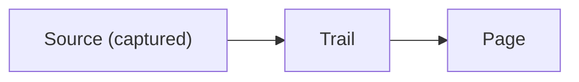

# Formatting reference

Every construct den-wiki supports, each rendered and then shown as source. They render in OpenKnowledge's editor and come through its re-save unchanged (checked against OpenKnowledge 0.88.11). The rules are in the den-wiki content contract, "Supported formatting". Long pages should use them: sections, tables, diagrams and full-size figures make a long page readable where a wall of text is not.

## Sections

Use `##` for sections and `###` below them. The editor's outline lists them, and the curation scan gives a page in three or more sections twice the length allowance.

## Tables

| Construct | Use it for |
|---|---|
| Table | Comparisons, settings, timelines |
| Task list | Open items on a hub |

~~~markdown
| Construct | Use it for |
|---|---|
| Table | Comparisons, settings, timelines |
~~~

## Task lists

- [x] A finished item
- [ ] An open item

~~~markdown
- [x] A finished item
- [ ] An open item
~~~

## Citations

Agents that keep an external memory answer follow-ups more consistently.[^1]

[^1]: [The memory survey](../sources/agent-memory-survey.md) "Agents that keep an external, editable memory answer follow-up questions more consistently"

~~~markdown
Agents that keep an external memory answer follow-ups more consistently.[^1]

[^1]: [The memory survey](../sources/agent-memory-survey.md) "Agents that keep an external, editable memory answer follow-up questions more consistently"
~~~

## Callouts

> [!NOTE]
> A note. TIP, IMPORTANT, WARNING and CAUTION work the same way.

~~~markdown
> [!NOTE]
> A note. TIP, IMPORTANT, WARNING and CAUTION work the same way.
~~~

## Collapsible sections

Method details

Long material most readers can skip.

~~~markdown

Method details

Long material most readers can skip.

~~~

## Diagrams

~~~markdown

~~~

## Math

Inline $E = mc^2$, and a block:

$$
\int_0^1 x^2 \, dx = \frac{1}{3}
$$

~~~markdown
Inline $E = mc^2$, and a block:

$$
\int_0^1 x^2 \, dx = \frac{1}{3}
$$
~~~

## Figures

Attach the image at full size with `wiki_attach` and paste the embed it returns. Caption it with an italic line directly below.

*Figure 1. A test card at its full 2400 by 1350 pixels; the editor fits it to the column and opens it full size on click.*

~~~markdown

*Figure 1. A test card at its full 2400 by 1350 pixels; the editor fits it to the column and opens it full size on click.*
~~~

## Animated GIFs

An animated GIF is an image like any other.

*Figure 2. A three-second animated test pattern.*

~~~markdown

~~~

## Sized images

For a fixed display width, use the `img` element with `alt`. Only then: moving the page rewrites Markdown image links, but not an `img` element's `src`.

~~~markdown

~~~

## Video

Video lives in the media store, outside git; `wiki_attach` returns the embed.

<video src="/media/{{CLIP}}.mp4" controls preload="metadata" title="A test pattern with a tone" />

*Clip 1. A four-second test pattern with a tone.*

~~~markdown
<video src="/media/<sha256>.mp4" controls preload="metadata" title="A test pattern with a tone" />
~~~

## What not to use

- A bare asset name such as ``. OpenKnowledge suggests it, but it does not resolve; use `./<page>.assets/<file>`.
- `<figure>` and `<figcaption>`. The editor shows them as text; caption with an italic line instead.
- Hotlinked images (``). They are not captured, hashed or durable; attach the file.
- `[[wikilinks]]` and reference-style link definitions; see the content contract.
